<!-- versão 2: mais animada e com partes clicáveis -->
<div align="center">
  
  
  <br/>
  <a href="#sobre"></a>
  <a href="#codigo"></a>
  <a href="#projetos"></a>
  <a href="#carreira"></a>
  <a href="#contacto"></a>
</div>

<a id="sobre"></a>
<div align="center">
  
  
</div>

<a id="codigo"></a>
<div align="center">
  
  
</div>

<a id="projetos"></a>
<div align="center">
  
</div>

<details>
<summary></summary>

**[Um CV por Vaga](https://umcvporvaga.pt)** — colas o anúncio da vaga e a IA reescreve o teu CV para essa vaga, sem inventar experiência. Depois envia a candidatura pelo teu Gmail.
Login com Google, pagamentos com Stripe, IA com a API do Gemini. · [repositório](https://github.com/NicolasKCost/um-cv-por-vaga)
</details>

<details>
<summary></summary>

**[MovAI-Fit](https://movaifit.me)** — app de treino instalável no telemóvel (PWA). A IA gera planos de treino e os personal trainers têm uma área própria para os alunos. · [repositório](https://github.com/NicolasKCost/movai-fit)
</details>

<details>
<summary></summary>

**Portal de Boletos** — plugin WordPress feito para uma clínica de saúde: importa os boletos em PDF, envia cada um por e-mail ao cliente certo e dá a cada cliente uma área para os consultar. · [repositório](https://github.com/NicolasKCost/portal-boletos)
</details>

<details>
<summary></summary>

**[Zágora](https://zagora.space)** — assistente de finanças no Telegram: registas gastos, contas e metas a conversar. As datas e os valores passam por regras em PHP para a IA não se enganar, e há testes automáticos. · [repositório](https://github.com/NicolasKCost/zagora)
</details>

<a id="carreira"></a>
<div align="center">
  
  
  
</div>

<details>
<summary></summary>

```diff
+ DESENCRIPTADO COM SUCESSO
+ Antes do código, passei mais de 8 anos no design gráfico.
+ Dei aulas de informática a crianças e de design a adultos.
+ Fui técnico de informática e sistemas numa associação de saúde.
+ Hoje junto tudo isso: código que funciona e interfaces que se percebem.
```
</details>

<a id="contacto"></a>
<div align="center">
  
  <br/>
  <a href="https://www.linkedin.com/in/nicolas-kaiky"></a>
  <a href="https://umcvporvaga.pt"></a>
  <br/><br/>
  <a href="#sobre"></a>
</div>
