<!-- banner -->

  
  

<!-- quem sou -->

  

> Comecei no design gráfico, passei pelo helpdesk e por anos como técnico de informática e sistemas. Hoje crio aplicações web completas, da base de dados à publicação em servidor.

<!-- stack -->

  

<!-- projetos -->

  
   
  
  
  
  

<!-- carreira -->

  

<!-- estatísticas (atualizadas todos os dias pelo GitHub Actions) -->

  
    
  
  

<!-- contacto -->

  
   
  
  
    
  

